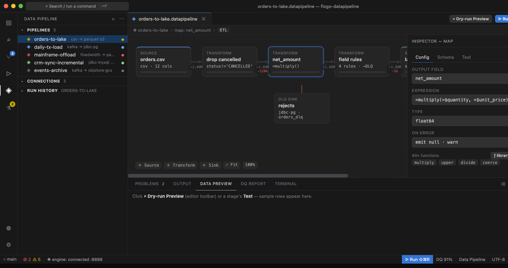
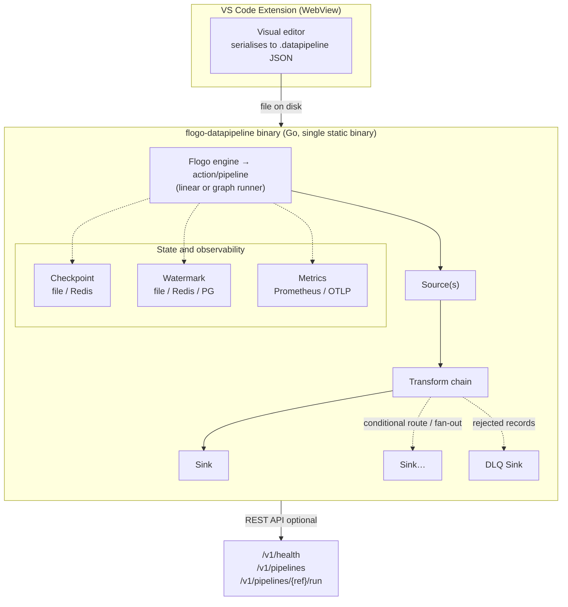

# Flogo Data Pipeline

A lightweight, embeddable **data pipeline engine** built on the [Project Flogo](https://github.com/project-flogo/core) runtime, with a **visual authoring experience inside VS Code**.

**Single static Go binary** · **visual VS Code editor** · **12 sources** · **10 sinks** (incl. DLQ) · **15 transforms** · checkpoint / watermark / schema-drift / data-quality / DLQ · Prometheus + OpenTelemetry · sharded & distributed scaling



> The VS Code Studio — a visual canvas for `.datapipeline` files: source → transform chain → sink with a DLQ branch, a per-stage inspector, dry-run preview, a data-quality report, and per-pipeline run history, all driven by the same `flogo-datapipeline` binary.

---

## Quick start

### Prerequisites

- Go 1.25+ (to build from source)
- VS Code 1.83+ (for the visual editor)

### Build the binary

```bash
git clone https://github.com/mpandav-tibco/flogo-datapipeline
cd flogo-datapipeline
go build -o flogo-datapipeline ./cmd/flogo-datapipeline/
```

> This default build has no private dependencies and works from a plain clone.
> It omits the OOTB App Startup/App Shutdown triggers (a TIBCO-internal module) —
> see [Deployment](docs/deployment.md#tibco-general-hooks-app-startupshutdown-triggers)
> if you need those.

### Run an example

```bash
./flogo-datapipeline -f examples/02-filter-and-map/filter-and-map.datapipeline
```

### Author visually in VS Code

1. Open VS Code → Extensions → `…` → **Install from VSIX…**
2. Select the packaged `studio/vscode/flogo-datapipeline-studio-*.vsix`
   (build it with `cd studio/vscode && npm install && npm run package && npx vsce package`)
3. Set the binary path in settings: `flogoDataPipelineStudio.binaryPath`
4. Open any `.datapipeline` file and click **Run** in the canvas toolbar.

---

## What it is

### The engine (Go binary)

A single Go binary (`flogo-datapipeline`) that reads a `.datapipeline` file, instantiates a pipeline from the Flogo resource descriptor, and runs it: a **source** streams batches through an ordered **transform chain** into a **sink**, with rejected rows routed to an optional **DLQ sink**. It exposes an optional REST API (`/v1/…`) for health checks, triggering runs, reading run history, and runtime create/replace of pipeline definitions, and can be embedded in a larger Flogo application or run standalone.

Pipelines are not limited to a single chain: when a `.datapipeline` declares a
non-linear **graph** — multiple sources, multiple sinks, or conditional routing — a
streaming [graph (DAG) runner](docs/graph.md) executes it directly, with every
transform supported.

### The VS Code extension

A custom editor for `.datapipeline` files that gives you:

- A visual canvas to compose source → transform chain → sink (plus a DLQ branch)
- A properties panel to configure each stage — no raw JSON editing required
- Plain-language structured editors for columns, field mappings, validation
  rules, data-quality expectations, filters and the JDBC conflict key
- **Reusable connections** — define a database / stream / object-store / HTTP
  endpoint once as a `*.fgconn` file and bind it by name on any source or sink.
  Secrets are kept in VS Code Secret Storage, never written to a file
- **Schema inference** — one click samples a CSV/TSV/JSON-lines file to fill in
  column names and types
- File/folder browse buttons for path inputs
- One-click run and stop with streamed status, plus a side-effect-free dry-run
  preview into the native Data Preview panel
- Pipeline templates to bootstrap new pipelines in seconds
- **Build & deploy** — export a standalone binary, a Dockerfile, or a deployment
  bundle (Dockerfile + sharded Kubernetes StatefulSet manifest + README)
- An organized project layout (`pipelines/`, `connections/`, `data/`) and
  sidebar views for pipelines (with per-pipeline run history) and connections

See [`studio/vscode/README.md`](studio/vscode/README.md) for full details.

---

## What is available today

### Sources (12)

| Source | What it reads |
|---|---|
| CSV / TSV | Delimited text files with optional header row; configurable separator (TSV is the tab-separated variant) |
| Fixed-Width (EBCDIC) | Positional flat files from mainframe systems; EBCDIC-037/500 encoding, implied decimal support |
| Parquet | Columnar Parquet files with row-group parallelism and column/predicate pushdown |
| Avro | Row-oriented Avro Object Container Files (OCF); schema-on-read, header codec auto-detect |
| XML | Streaming SAX-style XML; one record per named element |
| JSON Lines / NDJSON | Newline-delimited JSON, one object per row |
| JDBC | SQL query over PostgreSQL, MySQL, SQL Server, or Oracle with keyset-pagination chunking and high-water-mark predicate injection |
| Kafka | Consumer group-based consumption with offset checkpointing; JSON, Avro (Confluent Schema Registry), or raw deserialization |
| Cloud Object Store | Files from S3, Google Cloud Storage, or Azure ADLS Gen2; remote Parquet uses range-GET pushdown (footer + selected column chunks only, no whole-object download) |
| Text Document (sectioned) | Flat files with a key/value header block plus a delimited body table |
| Kubernetes Pod Logs (podlog) | Kubernetes / CRI container logs; one record per log line |
| REST/API | Generic paginated HTTP(S) JSON API; page / offset / cursor pagination, bearer / basic / apikey auth |

### Sinks (9 + DLQ)

| Sink | What it writes |
|---|---|
| CSV / TSV | Delimited text files with optional header row |
| JSON Lines / NDJSON | One JSON object per line |
| JDBC | Bulk insert / upsert into PostgreSQL, MySQL, SQL Server, or Oracle; configurable conflict strategy, optional auto-migrate |
| Parquet | Row-group-aligned Parquet output; snappy / gzip / zstd compression |
| Avro | Row-oriented Avro OCF output; snappy / deflate / zstandard / null, nullable-union schema |
| Kafka | SyncProducer with configurable acks and compression; JSON serialization (Avro sink serialization is not yet implemented and falls back to JSON) |
| Cloud Object Store | S3, GCS, or Azure Blob; output key supports date/uuid macros |
| Template | Go `text/template` rendering for fixed-width and legacy layouts |
| Null | Discards all rows (benchmarking and dry-run) |
| **Dead Letter Queue (DLQ)** | Wraps any sink type; captures rejected rows with an error envelope |

### Transforms (15)

| Transform | What it does |
|---|---|
| Filter | Row-level boolean expression; non-matching rows are dropped |
| Map | Field projection, rename, type coercion, and expression-derived columns |
| Validate | Per-field rules (not-null, min, max, pattern, enum); violations route to DLQ or fail-fast |
| Lookup / Enrich | HTTP enrichment with LRU cache; appends columns from an external API call |
| Parse | Extracts columns from a text field via regex named groups or JSON |
| High-Water Mark (HWM) | Tracks the maximum value of a column per batch for incremental load patterns |
| Schema Drift | Detects column additions, removals, and type changes at runtime; policies: `additive`, `project`, `strict`, `drop` |
| Data Quality (DQ) | Evaluates per-column expectations; produces a DQ report with pass/fail scores |
| Cast | Converts one or more columns to a target type (string / int / float / decimal / bool / date), updating the batch schema |
| Explode | Expands an array column into one row per element |
| Flatten | Flattens nested-object columns into dotted top-level columns |
| Router / Split | N-way routes rows to different sinks by ordered predicates (conditional split) |
| Join | Keyed stream-table join enriching the stream from a source-loaded reference dataset |
| Window | Event-time windowed aggregation (tumbling / sliding / session / global) with watermarks and checkpointed state |
| Union | Appends one or more bounded secondary datasets into the stream (N→1, `UNION ALL` semantics) |

### Operational primitives

| Feature | Backends available |
|---|---|
| Execution mode | `etl` (transform in-flight), `el` (extract-load, no transforms), `elt` (load raw, transform in-target) |
| Checkpointing (resume after interruption) | Local file, Redis |
| Watermarking (incremental high-water marks) | Local file, Redis, PostgreSQL |
| Metrics | Prometheus endpoint (`/metrics`) + OpenTelemetry OTLP gRPC export |
| Governance | Optional append-only audit log (JSONL) + OpenLineage run events (console / file / http) |
| Distributed scaling | Sharded (static partition assignment) or distributed (PostgreSQL or Redis work-queue coordinator with lease-based claim, heartbeat, and retry) |

### Pipeline templates (6)

Ready-to-run templates in the VS Code extension:

- CSV → PostgreSQL (ETL with filter + map)
- Parquet on S3 → JDBC (ETL with validate + map, Redis checkpoint, scaling config)
- Database → Database incremental sync (HWM-driven)
- Kafka → JDBC streaming ETL
- Mainframe EBCDIC → PostgreSQL
- Extract & Load only (EL mode, no transforms)

### Examples (24)

Working examples covering the common source families and transforms, incremental loading (with file / Redis / PostgreSQL watermark backends), schema drift, data quality, event-time windowed aggregation, format conversion, Prometheus and OpenTelemetry metrics, checkpoint/resume, horizontal scaling (sharded and distributed), Kafka streaming, and a full production pipeline composition.

### Extending it

Sources, sinks, and transforms are a **plugin contract**: implement one interface,
register it in an `init()`, and activate it with a blank import — in your own Go
module, without touching the engine. See [extending the engine](docs/extending.md)
and the runnable [out-of-tree example](examples/extension-plugin/).

---

## Architecture



The `Source → Transform chain → Sink` spine above is the common **linear** case. A
pipeline can also declare a non-linear **graph** — multiple sources, multiple sinks,
or conditional routing — executed by the streaming
[graph (DAG) runner](docs/graph.md).

---

## Why we are building this

Enterprise integration teams spend a disproportionate amount of time on data movement: extracting records from one system, applying business rules, and loading them into another. Most tools in this space are either too heavy (full ETL platforms requiring dedicated infrastructure), too raw (hand-written scripts with no operational visibility), or too locked-in (cloud-vendor-specific services).

We are building Flogo Data Pipeline to fill the gap for teams that need:

- **A single deployable binary** — no JVM, no Docker required to get started, no cluster to manage for small-to-medium workloads.
- **A Flogo-native programming model** — pipelines are Flogo app JSON, so they compose naturally with existing Flogo triggers, activities, and the broader Flogo ecosystem.
- **A visual editor that lives in the developer's IDE** — the VS Code extension brings a canvas directly into the tool engineers already have open, with no browser, no SaaS account, no account required.
- **Honest operational primitives** — checkpointing, watermarking, schema drift detection, data quality scoring, and Prometheus metrics are first-class concepts, not add-ons.

This is an active project at an early stage. The sections above document what is **working today** and the [roadmap](#roadmap--whats-planned-next) below lists what is **planned next**.

---

## Where we fit: one platform, not a second stack

Flogo is already an **integration platform** — connectivity, triggers, API and event
flows. Flogo Data Pipeline adds **data integration** (ETL / ELT, bulk and incremental
movement) as a first-class Flogo paradigm, so a customer runs **both on one platform,
one runtime, one skill set**. This is not a bid to out-feature Informatica, Talend, or
Redpanda Connect — it removes the need to buy, run, and staff a *separate* ETL stack
alongside the integration one. The competition we care about is the **redundant second
stack**, not another tool in a feature grid.

### The challenge

Consolidation. Organisations — acutely in DACH — are collapsing tech stacks to cut
infrastructure, operations, and skills cost. Running application integration and data
integration on **separate** stacks doubles licences, runtimes, and people, and splits
governance across two vendors.

### The solution

A new Flogo `action` that turns Flogo into a first-class data-pipeline engine: a single
static Go binary (no JVM, no cluster) authored visually in VS Code — the **same**
runtime, tooling, and skills your integration flows already use.

### What consolidation buys you

| Key value | Payoff |
|---|---|
| **One solution for integration + pipelines** | Retire the redundant ETL stack — one runtime, one skill set, one governance surface |
| **Lowest possible TCO** | A deployed pipeline is a single ~8–14 MB binary; no per-connector SaaS metering; scales down to a job and up to sharded / distributed |
| **Author in VS Code** | No design SaaS, no extra account; near-zero onboarding, reuses existing Flogo skills |
| **Composability = expansion** | Pipelines compose with existing Flogo triggers and activities — every existing Flogo footprint becomes a data-integration expansion, not a new procurement |

### An honest scope

We cover the **common** integration and data-movement patterns — file / mainframe → lake
or database, database → database incremental sync, and Kafka → lake — with operational
primitives built in (checkpoint/resume, incremental high-water marks, schema-drift
policies, data-quality scoring, and a dead-letter queue), including enterprise formats
like EBCDIC / fixed-width mainframe, Parquet, and XML. We deliberately do **not** chase
the deepest specialist features — log-based CDC, MDM, data governance / catalog, or a
500+ SaaS-connector catalog. The aim is not to replace a specialist suite for every edge
case; it is to let **one platform** handle the bulk of a customer's integration *and*
data work, so the second stack — with its own vendor, licences, and headcount — is no
longer needed.

---

## Enterprise use cases we are targeting

These are the specific enterprise problems we are designing for:

### 1. Mainframe / legacy data offload

Large enterprises run critical record systems on mainframes producing EBCDIC-encoded fixed-width files. Getting that data into modern stores (PostgreSQL, S3, Parquet) typically requires specialised ETL tooling. The fixed-width source with EBCDIC/037/500 encoding and implied-decimal support is designed specifically for this pattern.

**Target:** On-prem to cloud migration; batch offload from mainframe batch jobs.

### 2. Incremental database synchronisation

Extracting full tables on a schedule is expensive and slow at scale. The HWM (high-water mark) pattern paired with the JDBC source and a watermark backend allows pipelines to resume from the last processed row across restarts.

**Target:** Database-to-database sync, operational data store refresh, CDC-light patterns.

### 3. Streaming Kafka ingestion into JDBC / data lake

Teams building event-driven architectures need a lightweight path from Kafka topics to relational databases or cloud data lakes without a full Kafka Streams or Flink deployment. The Kafka source + JDBC/Parquet/S3 sink path covers this.

**Target:** Event log archiving, operational reporting from event streams, streaming ETL into Snowflake-ready Parquet.

### 4. Data quality enforcement at ingestion time

Enterprises often discover data quality problems after they have propagated through multiple systems. The validate transform enforces per-field rules at ingestion time; violations are routed to a DLQ sink so bad records are captured, not silently dropped.

**Target:** Financial data ingestion, regulatory reporting, MDM feed processing.

### 5. Cloud data lake ingestion (Parquet / object store)

Teams loading data into data lakes need to land files in Parquet format on S3, GCS, or Azure Blob with correct row-group sizing for downstream query performance. The Parquet sink with row-group configuration and the object store sinks cover this.

**Target:** Data lake / lakehouse ingestion layer, Spark / Athena / BigQuery pre-processing.

### 6. Schema drift monitoring in live feeds

Production data feeds change over time without notice. The schema drift transform detects column additions, removals, and type changes at runtime and applies a configurable policy so pipelines do not silently break or silently ingest structurally invalid data.

**Target:** Third-party data feed ingestion, API-to-database pipelines, partner data exchange.

---

## Roadmap — what's planned next

These are honest work items — not committed roadmap, but the next things we intend to build:

### Engine

- [ ] **SFTP and local directory watch sources** — file-arrival triggered ingestion without cron

### VS Code extension

- [ ] **Inline validation error highlighting** — surface validate-transform failures as canvas annotations during test runs
- [ ] **Concurrent multi-pipeline runs** — the sidebar already lists and shows run history for every workspace pipeline; running several at once from one window is the remaining gap

### Longer-term (not yet scheduled)

- **Visual DQ report viewer** — a canvas panel showing per-field quality scores from the DQ transform output
- **Pipeline lineage metadata** — expose column-level lineage (what came from where) as a queryable artifact

---

## Documentation

The [`docs/`](docs/README.md) folder is the full product guide — [Getting started](docs/getting-started.md),
[Architecture](docs/ARCHITECTURE.md), the [Pipeline file](docs/pipeline-file.md), and per-topic references for
[sources](docs/sources.md), [sinks](docs/sinks.md), [transforms](docs/transforms.md),
[reliability](docs/reliability.md), [scaling](docs/scaling.md), [observability](docs/observability.md),
the [REST API](docs/rest-api.md), and [deployment](docs/deployment.md). To add your own sources, sinks, or
transforms, see [extending the engine](docs/extending.md). Each source, transform, and sink also has its own
**per-activity page** under [docs/sources/](docs/sources/), [docs/transforms/](docs/transforms/), and
[docs/sinks/](docs/sinks/); the [Feature matrix](docs/FEATURES.md) links them all.

---

## Contributing

This is an internal prototype at the moment. If you are on the team, open a PR and tag a reviewer. External contributions are not yet accepted while the core API is still stabilising.

---

## License

Private — not open source at this time.
