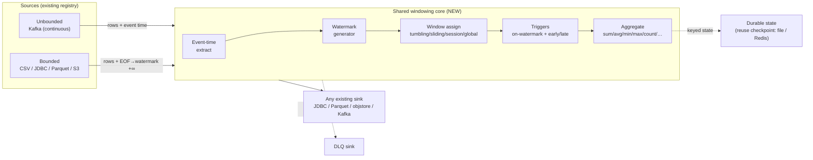

# Stream Processing for Flogo Data Pipeline — Approach & Design

> **Status:** Implemented — this design shipped as the [`window`](transforms/window.md)
> and [`join`](transforms/join.md) transforms; this page is kept as the design
> reference. It describes how **continuous, event‑time, windowed stream
> processing** was added to Flogo Data Pipeline as a natural extension of the
> existing batch engine — not as a separate product, and not as a clone of Flink/Beam.

---

## 1. One‑line thesis

> Add **Beam‑style windowed aggregation semantics** (event time, watermarks,
> windows, triggers) to the pipeline engine so the **same declarative config runs
> over both bounded (batch) and unbounded (streaming) sources** — delivered as a
> single Go binary, no JVM, no cluster, authored in the same VS Code canvas.

That "unified batch + stream in one lightweight runtime" is the wedge. We are
**not** competing on distributed‑cluster scale or multi‑runner portability.

---

## 2. Positioning & differentiators

We benchmark against these to *position*, not to reach feature parity.

| Aspect | Apache Flink | Kafka Streams | Apache Beam | Spark Structured Streaming | **Flogo Data Pipeline (+ stream)** |
|---|---|---|---|---|---|
| Deployment | JVM cluster (JobManager + TaskManagers) | JVM library in your app | Model + external runner | JVM cluster | **Single Go binary, no JVM, no cluster** |
| Batch + stream | Separate APIs (converging) | Stream only | Unified model | Unified | **Unified — one config, same visual tooling** |
| Edge / embeddable | No | Partial | No | No | **Yes — edge/IoT, single static binary** |
| Windowed state | Rich (keyed, event time) | Rich (KTable, windows) | Rich | Rich | **Target: tumbling/sliding/session + triggers** |
| Connectors | Many | Kafka only | Many | Many | **file / DB / object store / Kafka + Flogo ecosystem** |
| Authoring | Java/Python/SQL | Java/Scala DSL | Java/Python/Go/SQL | Scala/Python/SQL | **Declarative JSON + VS Code canvas + Go SDK** |
| Delivery guarantee | Exactly‑once (distributed) | Exactly‑once (Kafka) | Runner‑dependent | Exactly‑once | **Exactly‑once *results* via idempotent sinks (at‑least‑once core)** |
| Best fit | Complex CEP at cluster scale | Stream‑to‑stream inside Kafka | Portable pipelines | Lakehouse streaming | **Lightweight unified ETL + windowed aggregation, incl. the edge** |

**How we talk about it:** "Beam‑class windowed semantics without the cluster."
Do **not** market as "Apache Beam" — that invites a portability / exactly‑once
comparison we lose. Market the *model* at the edge — a comparison we win.

---

## 3. Goals / Non‑goals

**Goals**
- Event‑time processing with **watermarks** and **late‑data** handling.
- **Windows:** tumbling, sliding, session, global.
- **Triggers:** on‑watermark close + early/late firings; count‑ and processing‑time‑based.
- **Accumulation modes:** discarding, accumulating.
- **Keyed aggregation** (`groupBy`) with **durable** window state (survives restart).
- **One config runs on bounded and unbounded sources** (backfill == live logic).
- Reuse the entire existing engine: registries, `RecordBatch` streaming,
  checkpoint, watermark, sharding, DLQ, metrics, Studio, SDK.

**Non‑goals (explicit — protects scope & positioning)**
- ❌ Beam/Flink **portability / multi‑runner** — Flogo *is* the runtime.
- ❌ **Multi‑language SDK** / cross‑language transforms.
- ❌ **Distributed exactly‑once shuffle** — we do sharded + idempotent sinks.
- ❌ Autoscaling / dynamic work rebalancing / splittable‑DoFn.
- ❌ Reviving `project-flogo/stream` as‑is (stale multi‑module, `core` 0.10.1 vs
  1.6.5, `go 1.12`, `Info()` panics). **Borrow its window semantics, build fresh in‑repo.**

---

## 4. Core idea — unify batch & stream with one operator

The Beam insight we adopt: **a bounded source is just an unbounded one whose
watermark jumps to +∞ at end‑of‑input.** So a single windowing operator, fed a
watermark signal, produces correct results for *both* modes:

- **Batch / backfill** (CSV, JDBC, Parquet, object store): source emits all rows,
  then signals EOF → watermark → +∞ → every open window fires once.
- **Streaming** (Kafka continuous): source emits rows forever; watermark advances
  with event time → windows fire as time passes.



---

## 5. Stream-only pipelines

A **pure streaming pipeline is the primary case**, not a special mode. Because
*mode is emergent from the source* (bounded vs unbounded), a stream-only pipeline
is simply an unbounded source + the `window` operator + a sink, driven by a
long-running trigger. The window operator is identical to the batch case — it just
never sees an EOF, so windows fire on watermark/triggers as event time advances.
Embedding windowing as a *transform* does **not** trap it in batch mode: the chain
is mode-agnostic (like today's engine has no ETL/EL switch — mode is emergent).

**Composition** — an unbounded source (Kafka `mode:"streaming"`, or `podlog`)
driven by the **startup-hook** trigger (fires once on boot, runs forever — the same
driver the `podlog` tailer already uses):

```jsonc
{
  "name": "sensor-rollup-live",
  "source": { "type": "kafka",
    "options": { "brokers": "…", "topic": "sensors", "groupId": "rollup",
                 "mode": "streaming", "startOffset": "latest" } },   // unbounded -> runs forever
  "transforms": [
    { "type": "filter", "expr": "temperature > 0" },
    { "type": "window",
      "eventTime":  { "column": "ts", "format": "RFC3339" },
      "watermark":  { "strategy": "boundedOutOfOrderness", "maxLatenessMs": 5000 },
      "window":     { "kind": "tumbling", "sizeMs": 60000 },
      "groupBy":    ["sensor_id"],
      "aggregations":[ { "as": "avg_temp", "fn": "avg", "column": "temperature" } ],
      "trigger":    { "onWatermark": true },
      "stateTtlMs": 120000 }                                          // evict fired windows -> bounded memory
  ],
  "sink": { "type": "kafka", "topic": "sensor-rollups-1m" },
  "checkpoint": { "type": "redis", "intervalSeconds": 10 }            // periodic state snapshot
}
```

**Unification payoff:** swap `source` to `{ "type": "csv", "path": "history.csv" }`
and the *same* transforms replay history as a batch backfill (windows fire at EOF).
One config, both modes.

**What stream-only requires** (folded into the plan):
- **Window-state GC / TTL** — *mandatory*: on an infinite stream, fired windows must
  be evicted once allowed lateness passes, or memory grows unbounded → **Phase 1**
  (`stateTtlMs`).
- **Continuous checkpointing + offset commit** — periodic state snapshot for
  at-least-once recovery → **Phase 2**.
- **Long-running driver** — the startup-hook trigger already keeps the action alive
  while the source polls; no new engine work.
- **Optional `unbounded: true` (or `mode: "streaming"`) signal** — lets Studio render
  a *continuous* pipeline (live tail, no "completed" state, always-on metrics) rather
  than a run-to-completion job.

---

## 6. How it fits the existing engine

The engine already streams `RecordBatch`es Source → transform chain → Sink with
checkpointing and backpressure (see [docs/FEATURES.md](docs/FEATURES.md),
[action/pipeline/action.go](action/pipeline/action.go)). Stream processing plugs
into that spine and **reuses**:

| Existing asset | Reused for streaming as |
|---|---|
| Source/Sink/Transform registries | Window operator is a new registered transform; sources/sinks unchanged |
| `RecordBatch` streaming + `maxMemoryMB` backpressure | Same intake; windows buffer keyed state within budget |
| Checkpoint (`file`/`redis`) — [checkpoint/](checkpoint/) | **Durable window state** + watermark position |
| Watermark stores (`file`/`redis`/`postgres`) — [watermark/](watermark/) | Persist the **event‑time** watermark across restarts |
| Sharded scaling ([action/pipeline/scaling.go](action/pipeline/scaling.go)) | **Keyed partitioning** — route a `groupBy` key to one shard |
| DLQ sink — [sink/dlq/](sink/dlq/) | **Late/dropped events** routed, never silently lost |
| Metrics (Prometheus/OTLP) — [metrics/](metrics/) | Window/watermark/lateness gauges |
| VS Code Studio + SDK — [sdk/builder.go](sdk/builder.go) | Window/trigger config node + `.Window(...)` builder method |

**Interface gap to close.** Today `transform.Transform` is a per‑batch map:
`Apply(in *RecordBatch) (*RecordBatch, error)` (see
[transform/transform.go](transform/transform.go)). A windowed operator is **not**
1:1 with input batches — it consumes rows, holds keyed state, and **emits on
triggers**. We add a small stateful interface the engine drives explicitly:

```go
// WindowedOperator is an ordered, stateful stage the engine feeds rows and
// watermarks, and drains emitted results from on trigger firings.
type WindowedOperator interface {
    // AddBatch ingests rows (assigns windows, updates keyed state). It may
    // return early/partial results if a trigger fires as a result of the add.
    AddBatch(in *record.RecordBatch, wm Watermark) (emitted *record.RecordBatch, err error)
    // OnWatermark advances event time; returns windows that closed/fired.
    OnWatermark(wm Watermark) (emitted *record.RecordBatch, err error)
    // Flush finalizes all open windows (EOF for bounded sources).
    Flush() (emitted *record.RecordBatch, err error)
    // Snapshot / Restore persist keyed state to the checkpoint backend.
    Snapshot() ([]byte, error)
    Restore([]byte) error
    Close() error
}
```

The action loop advances a watermark after each source batch (event‑time for
streaming; monotonic → +∞ at EOF for batch) and writes any `emitted` batch to the
sink through the normal path.

---

## 7. New building blocks

1. **Event‑time extraction** — a configured timestamp column/expression per source
   (falls back to processing time when absent).
2. **Watermark generation** — `boundedOutOfOrderness(maxLatenessMs)` initially;
   pluggable later. Bounded sources emit a final +∞ watermark on EOF.
3. **Windows** — `tumbling`, `sliding`, `session(gap)`, `global`. Pure assignment
   library (borrow semantics from `project-flogo/stream/activity/aggregate/window`,
   rewritten with typed accumulators instead of its `interface{}` "4× slower" note).
4. **Triggers** — `onWatermark` (default), `early{everyMs|everyCount}`,
   `late{everyMs}`, `allowedLatenessMs`.
5. **Accumulation** — `discarding` (each firing = delta) vs `accumulating`
   (each firing = running total). Retractions are **out of scope** for v1.
6. **Keyed state + durable backend** — per‑`groupBy`‑key accumulators, snapshotted
   through the existing checkpoint backends for restart recovery.
7. **Aggregate functions** — `sum, avg, min, max, count, first, last, collect`
   (+ pluggable custom later).
8. **Windowed joins** — `CoGroupByKey`‑style keyed join within a window (later phase).

---

## 8. Where it lives — recommended shape

**Recommendation: a shared core package + a stateful `window` transform (hybrid).**

- `windowing/` (new Go package): window assignment, watermark, triggers,
  accumulators, keyed‑state store. **No engine dependency** → unit‑testable and
  reusable.
- `transform/window/` (new): registers a `window` transform implementing
  `WindowedOperator`, wrapping `windowing/`. Slots into the existing
  `transforms[]` chain, so pipelines stay "source → … → sink".
- The action loop learns to feed watermarks + drain emissions for any stage that
  implements `WindowedOperator`.

Why hybrid (vs. a per‑batch transform, or reviving the `stream` action):
- Keeps the **familiar pipeline model** and all Studio/SDK/registry plumbing.
- The core is **decoupled**, so a future first‑class streaming action (or the
  revived `stream` dimension) can reuse the exact same semantics — no rewrite.

---

## 9. Draft config schema

A windowed aggregation is one stage in the existing `transforms[]` array:

```jsonc
{
  "type": "window",
  "eventTime": { "column": "event_ts", "format": "RFC3339" },     // omit → processing time
  "watermark": { "strategy": "boundedOutOfOrderness", "maxLatenessMs": 5000 },
  "window":    { "kind": "tumbling", "sizeMs": 60000 },            // sliding{sizeMs,slideMs} | session{gapMs} | global
  "groupBy":   ["sensor_id", "region"],
  "aggregations": [
    { "as": "avg_temp", "fn": "avg",   "column": "temperature" },
    { "as": "max_temp", "fn": "max",   "column": "temperature" },
    { "as": "n",        "fn": "count" }
  ],
  "trigger":       { "onWatermark": true, "early": { "everyMs": 10000 }, "allowedLatenessMs": 60000 },
  "accumulation":  "accumulating",                                 // or "discarding"
  "emit":          { "windowStartAs": "w_start", "windowEndAs": "w_end" },
  "onLate":        "route"                                          // route → DLQ | drop
}
```

The output batch carries `w_start`, `w_end`, the `groupBy` keys, and the aggregate
columns — then flows to any existing sink. SDK equivalent: a `.Window(WindowSpec{…})`
builder method on [sdk/builder.go](sdk/builder.go).

---

## 10. Phased delivery plan

Each phase is independently shippable and demoable.

| Phase | Theme | Deliverables | Acceptance criteria |
|---|---|---|---|
| **Spike** | De‑risk | Minimal event‑time + tumbling + `sum` over **CSV** and **Kafka** through the shared core | *Same* `window` config produces matching per‑key results on a bounded CSV and its Kafka replay |
| **0** | Foundations | `windowing/` core (assign + typed accumulators); `window` transform; `WindowedOperator` engine hooks; processing‑time tumbling/sliding | CSV → `window(groupBy)` → sink correct at 2M rows within `maxMemoryMB`; unit tests |
| **1** | Correctness + bounded memory | Event‑time extract; `boundedOutOfOrderness` watermark; allowed‑lateness + `onLate` route/drop; **session** windows; **window-state GC/TTL** (`stateTtlMs`) so unbounded streams stay memory-bounded; **stream-only smoke** (continuous Kafka + startup-hook) | Out‑of‑order input yields correct event‑time windows; late rows routed to DLQ; session gaps verified; a **continuous stream-only** pipeline runs indefinitely with **bounded memory** (fired windows evicted past allowed lateness) |
| **2** | Semantics + resilience | Trigger subsystem (early/late); discarding vs accumulating; **durable keyed state** via checkpoint + recovery | Early firings emit partials; kill/restart resumes state with no double‑count (accumulating + idempotent sink) |
| **3** | Continuous + scale | Continuous Kafka driver on the same core; keyed partitioning aligned to sharded scaling; backpressure with stateful windows; **spillable state backend** (embedded KV) for high-cardinality key-spaces | Unbounded Kafka run matches bounded replay; N‑way shard by key; bounded memory under sustained load and high key cardinality (via spill) |
| **4** | Productization | Windowed keyed **join**; Studio window/trigger node; window/watermark/lateness **metrics** | Join example passes; Studio round‑trips window config; metrics exported to Prometheus/OTLP |

---

## 11. Decisions (resolved 2026‑07‑24)

All calls are made; residual sub‑questions are flagged inline.

1. **State backend — DECIDED: `StateStore` interface — in‑memory default + a spillable backend.**
   Target includes **server‑side, high‑cardinality** key‑spaces (not edge‑only), so bounded‑memory
   spill is a **planned deliverable, not deferred**: in‑memory (fast path, small cardinality) →
   embedded‑KV spill‑to‑disk (single‑node high cardinality — keeps the no‑cluster story) → Redis
   shared state (multi‑instance). `maxMemoryMB` triggers spill/backpressure; lands with scale in **Phase 3**.
2. **Watermark plumbing — DECIDED: explicit `WindowedOperator` interface (§6).**
   The engine drives `AddBatch` / `OnWatermark` / `Flush`; the batch transform path stays untouched.
3. **Key ↔ shard routing — DECIDED: co‑partitioning constraint, no shuffle.**
   The source partition key must cover the `groupBy` key (validated at load + documented — the same
   model as Kafka Streams). When alignment can't be guaranteed, fall back to a **single instance for
   the keyed windowed stage** (shard only stateless stages). We do **not** build a cross‑instance
   shuffle — that stays outside the "no cluster" line.
4. **Delivery guarantee — DECIDED: at‑least‑once core, positioned as "exactly‑once *results*".**
   Mechanism = at‑least‑once + **idempotent (upsert) sinks** + checkpointed state. Customer‑facing
   wording = *"exactly‑once results"*, **always** paired with the idempotent‑sink precondition and
   **never** implying distributed/transactional exactly‑once. (This is already how the Kafka → JDBC
   path behaves today.)
5. **Time default — DECIDED: event‑time when a timestamp column is set; else processing‑time + a loud warning.**
   The fallback raises a Problems‑panel diagnostic (*"no eventTime set → processing time; late /
   out‑of‑order data will be mis‑bucketed"*).
6. **Backfill semantics — DECIDED: on EOF, watermark → +∞ → fire all open windows once (`Flush()`).**
   `allowedLateness` is moot post‑EOF and final aggregates match the live path. Replaying the exact
   intermediate early/late firing *sequence* during backfill is out of scope (revisit only if a
   customer needs bit‑identical reprocessing).

---

## 12. Appendix — mapping to the Beam ("Dataflow") model

| Beam question | Beam mechanism | This design |
|---|---|---|
| **What** is computed | ParDo / Combine | `aggregations[]` (+ existing map/filter transforms) |
| **Where** in event time | Windowing (fixed/sliding/session/global) | `window.kind` |
| **When** results fire | Triggers (watermark, early/late, data‑driven) | `trigger` |
| **How** refinements relate | Accumulation (discarding/accumulating[/retracting]) | `accumulation` (no retractions v1) |
| Correctness over late data | Watermarks + allowed lateness | `watermark` + `trigger.allowedLatenessMs` + `onLate` |

We adopt the **model**; we deliberately skip Beam's **portability/runner** layer.

---

## 13. Delivery semantics & durable resume (implemented + verified)

The window operator's keyed state is **checkpointed and restored** so a streaming
pipeline survives a restart. Mechanism:

- On each checkpoint (row/time interval or completion) the engine takes an
  `Operator.Snapshot()` — a compact JSON of every open window's per‑key
  accumulator internals, the early‑fire cadence, and the current watermark — and
  stores it **inside the checkpoint `Token`** (`Token.WindowState`), captured at
  the *same instant* as the source position. File and Redis backends persist it
  verbatim (whole‑token JSON); no backend change is needed.
- On resume the engine loads the token and calls `Operator.Restore()` before
  reading, so open windows and their aggregations continue exactly where they
  stopped. Set `checkpoint.key` to a stable value (e.g. the pipeline name) so a
  single‑instance streaming job finds its state across restarts — otherwise the
  per‑run id is used (correct for batch, useless for resume).
- **Guarantee (per §11.4): at‑least‑once, no loss.** With `source.commitMode:
  "checkpoint"` the Kafka source disables auto‑commit and the engine commits
  offsets only *after* the checkpoint token is durable **and only up to the offset
  the pipeline has actually processed**. Because the consumer reads ahead of
  processing, the source records a per‑batch offset mark of
  `(cumulative rows returned → next offset)` and commits at the pipeline's
  processed‑row boundary — so read‑ahead still in flight is never committed and a
  crash re‑delivers everything after the last checkpoint (nothing lost). The token
  also carries that processed offset `Cursor` (`payload`) atomically with the
  window state. Pairing this with an **idempotent (upsert) sink** keyed by
  `(key, windowStart)` yields **exactly‑once *results***. Two load‑time checks
  enforce a sound configuration: `commitMode:"checkpoint"` is rejected without a
  durable checkpoint backend, and a **windowed** Kafka pipeline that persists to a
  checkpoint backend is rejected in the default `commitMode:"auto"` — auto‑commit
  advances offsets on an independent 1 s timer, uncoordinated with the
  window‑state snapshot, so a restored window would not align with the resumed
  offset (double‑ or under‑counting on restart). Windowed Kafka pipelines must
  therefore run in `commitMode:"checkpoint"`, which co‑commits the offset with the
  token; non‑windowed pipelines keep today's sarama auto‑commit behaviour.
  **On resume the source seeks to the exact per‑partition offsets recorded in the
  token** — pre‑seeding the consumer group's committed offset (via a short‑lived
  offset manager) *before* the group joins — so the restored window state and the
  source position always advance from the same token, independent of whether the
  last external offset commit succeeded. This closes the
  crash‑between‑token‑and‑commit window: a commit that never landed is healed on
  restart because the token offset (always ≥ the last committed offset) becomes
  the authoritative resume position, giving **bit‑exact once** resume.

**Verified live (2026‑07‑24, real Kafka):** a consumer buffered two events into an
open 1‑minute window and checkpointed the state; the process was killed; a fresh
process logged `restored window state (575 bytes)`; a later event advanced the
watermark and the restored window fired with the **exact pre‑crash aggregate**
(`avg=20.75 max=21 n=2`) — no double‑count, no loss. See
[`examples/25-kafka-windowed-stream`](../examples/25-kafka-windowed-stream/README.md).

## 14. Status & next actions

- [x] §11 decisions resolved (2026‑07‑24).
- [x] **Phase 0** — `windowing/` core (tumbling/sliding/session/global, event‑time,
  watermarks) + `window` transform; blank‑imported in the engine.
- [x] **Phase 1** — session windows, state TTL, late data `onLate: drop|route`,
  observability (`windowStats` in run output + logs).
- [x] **Phase 2** — early‑firing triggers + discarding/accumulating modes; durable
  keyed state (`Snapshot`/`Restore`) wired through the checkpoint (§13).
- [x] **Phase 4 (partial)** — Studio `window` node (visual editor) + schema/syntax;
  window observability gauges (`flogo_pipeline_window_open`, `…_emitted_total`,
  `…_late_dropped_total`, `…_state_evicted_total`, `…_watermark_ms`) emitted through
  the configured metrics backend at each checkpoint and at end‑of‑run.
- [x] **Phase 3 (partial)** — co‑partition guard: a keyed window (`groupBy`) is
  rejected at load under `sharded`/`distributed` scaling, because the rowgroup/
  file/byterange partition strategies split by position, not by key, and would
  produce split aggregates. Run windowed pipelines in `single` mode (or scale a
  Kafka source partitioned by the `groupBy` key, which is orthogonal to
  `scaling.mode`).
- [x] **Phase 3 spillable state** — bounded‑memory `stateStore`: keeps only
  `state.maxResidentKeys` keys resident (LRU) and pages colder keys to per‑key
  files under `state.spillDir` (default OS temp), so a single instance can
  aggregate over high‑cardinality key spaces without OOMing. Emit scans page cold
  keys transiently; only surviving (active) keys stay resident. Snapshot/Restore
  stream keys one at a time (bounded memory) and span spilled keys, so durable
  resume is unaffected. `maxResidentKeys` bounds key *count* (a memory proxy, not
  a byte cap); a `…_spill_failures_total` gauge surfaces any keys dropped when a
  spill write fails.
- [x] **Phase 3 coordinated commit** — Kafka `commitMode: "checkpoint"` commits
  offsets only after the checkpoint token is durable and only up to the pipeline's
  processed‑row boundary (read‑ahead‑safe, via per‑batch offset marks); records the
  offset cursor in the token atomically with window state
  (`source.Committer(processedRows)` + `Cursor`). Default `auto` is unchanged; a
  load‑time check requires a durable checkpoint backend for `checkpoint` mode.
- [x] **Phase 3 bit‑exact resume** — on resume the Kafka source seeks to the exact
  per‑partition offsets recorded in the checkpoint token (pre‑seeding the consumer
  group's committed offset via a short‑lived offset manager before the group
  joins), so window state and source position resume from the same token
  regardless of whether the last external offset commit landed. Verified live: a
  fresh group seeking to offset 3 of 5 delivers only the last two records.
- [x] **Phase 4 keyed JOIN** — `join` transform: keyed stream‑table join against a
  source‑loaded reference table (inner/left, many‑to‑many, right‑column selection
  + prefix). Composes with `window` for a **windowed keyed join** (join to enrich →
  window + aggregate). A true stream‑stream *temporal* join (two live streams)
  remains a follow‑up — it needs dual‑source pipeline support.
- [x] **Phase 4 Studio config** — window editor gains trigger (early firing),
  accumulation, spillable‑state, and late‑route‑sink controls; a new `join` node
  with a keys / join‑type / reference‑source editor; JSON‑schema autocomplete for
  the `join` transform and Kafka `commitMode`.