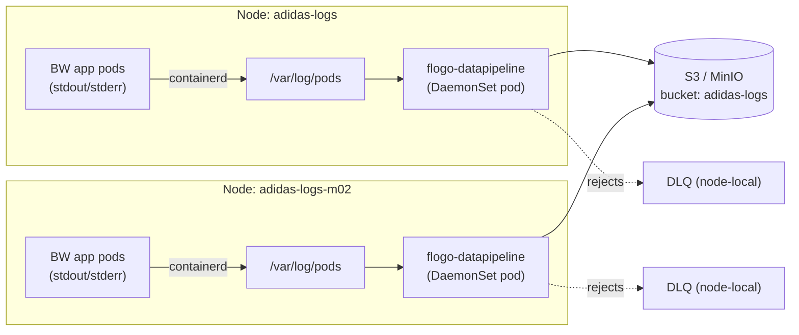

# adidas — Container Log Collection with Flogo Data Pipeline

Replace a per-node **Fluentd DaemonSet + custom S3-pusher service** with a single
**Flogo Data Pipeline** collector that tails BW6/BWCE container console logs and
streams enriched NDJSON straight to an S3 bucket — eliminating the intermediate
processing hop and the OpenSearch index-corruption failure mode.

This example is fully deployable on a local **minikube** cluster with a host
**MinIO** as the S3 target.

---

## The problem (current architecture)

```
BW app ──stdout/stderr──► Fluentd DaemonSet ──► background convert service ──► S3 ──► OpenSearch
   (console)               (per node)            (custom format conversion)         (index — occasionally corrupts)
```

Pain points:
- **Two extra moving parts** (Fluentd + a custom converter service) between the app and S3.
- **OpenSearch indices occasionally corrupt**, so logs silently stop being indexed/searchable.
- Format conversion + S3 push logic is bespoke and hard to reason about at scale
  (3 nodes · ~20 namespaces/node · 5–200 apps/namespace · ~25M records/day).

## The solution (this example)

```
BW app ──stdout/stderr──► /var/log/pods ──► Flogo Data Pipeline DaemonSet ──► S3 (MinIO)
   (console)              (CRI, per node)     podlog → map → parse → validate → s3-sink
                                              (multiline stitch · enrich · structure · route)
```

One collector per node (a DaemonSet, exactly like Fluentd), reading node-local
CRI logs. No intermediate service. **S3 is the durable source of truth**; any
downstream index (OpenSearch, Athena, Snowflake, …) can be rebuilt from S3, so an
index corruption never means lost logs.



### Old → new mapping

| Old component | Replaced by |
|---|---|
| Fluentd DaemonSet (per node) | `flogo-datapipeline` **DaemonSet** (`podlog` source tails `/var/log/pods`) |
| Multiline handling (Fluentd concat plugin) | `podlog` **multiline** stitching (Java stack traces → one record) |
| Background format-conversion service | in-pipeline **map + parse** transforms (enrich + structure) |
| Custom S3 pusher | **s3-sink** (partitioned, rolling objects, native MinIO/S3) |
| Dropped/oversized logs → lost | **validate → DLQ** (node-local, reconcilable) |
| At-least-once? (unclear) | **checkpoint + position registry** = at-least-once with idempotency key |

---

## What lands in S3

Objects are partitioned by namespace / pod / date and rolled by size or time:

```
adidas-logs/
  team-alpha/order-service-<pod>/2026/07/17/adidas-logs-1109-<uuid>-0000.ndjson
  team-beta/inventory-service-<pod>/2026/07/17/adidas-logs-m02-1109-<uuid>-0000.ndjson
  ...
```

Each line is an enriched, **OpenSearch-ready** record (structured in the pipeline
so no fragile downstream parsing is needed):

```json
{
  "@timestamp": "2026-07-17T11:09:20.035793012Z",
  "event_time": "2026-07-17T11:09:20.035",
  "log_level": "ERROR",
  "severity": 4,
  "is_error": true,
  "logger": "com.tibco.bw.OrderService.HTTPReceiver",
  "thread": "bwEngThread:In-Memory Process Worker-5",
  "message": "Unhandled fault ...\njava.lang.NullPointerException: ...\n\tat com.tibco.bw...",
  "raw_log": "2026-07-17T11:09:20,035 ERROR [bwEngThread:...Worker-5] com.tibco.bw.OrderService.HTTPReceiver - Unhandled fault ...",
  "service_name": "order-service",
  "namespace": "team-alpha",
  "pod": "order-service-6c85fd4575-dgfdz",
  "container": "bwapp",
  "node": "adidas-logs",
  "stream": "stdout",
  "cluster": "adidas-logs-demo",
  "environment": "production",
  "collector": "flogo-datapipeline",
  "ingest_time": "2026-07-17T11:09:20Z",
  "ingest_date": "2026-07-17",
  "index_hint": "bwce-logs-2026-07-17",
  "idempotency_key": "545956ba842ba9e8..."
}
```

The pipeline preprocesses each event for analytics: a canonical **`@timestamp`**
(ISO8601 UTC, the OpenSearch time field), normalized **`log_level`** + numeric
**`severity`** (for range filters/alerts), an **`is_error`** flag, **`service_name`**
(pod-hash stripped, for grouping), and a daily **`index_hint`** (`bwce-logs-YYYY-MM-DD`).
A multiline Java stack trace is stitched into a **single** record (`message` /
`raw_log` carry the embedded newlines), so exceptions are never split.

---

## Layout

```
adidas-log-collection-usecase/
  adidas-log-collector.datapipeline   # the pipeline (podlog → parse → map[enrich+OpenSearch prep] → validate → s3-sink + DLQ)
  collector/
    Dockerfile                        # runtime image (bakes the prebuilt arm64 engine binary)
    build-image.sh                    # builds+loads the collector & emitter images into minikube
  workload/
    emitter.py                        # arm64 BWCE-format log emitter (stand-in for the BW app)
    Dockerfile                        # emitter image
    bwce-app/Dockerfile               # REAL BWCE app image (amd64) from the EAR — see "BW workload" below
  k8s/
    00-namespaces.yaml                # logging + 6 team namespaces
    10-workload.yaml                  # 6 BW-app emitter deployments (2 replicas each)
    15-bwce-real-app.yaml             # the REAL licensed BWCE app (team-bwce)
    20-collector-secret.yaml          # MinIO credentials (env-var names referenced by the pipeline)
    25-collector-config.yaml          # per-environment app-property overrides (edit ONLY this per env)
    40-collector-daemonset.yaml       # the collector DaemonSet
  scripts/
    deploy.sh                         # one-shot deploy (idempotent)
    deploy-real-bwce.sh               # optional: build+deploy the real licensed BWCE app
    verify.sh                         # end-to-end verification (+ S3 listing)
    teardown.sh                       # cleanup
  REPORT.md                           # tested run results
```

---

## Prerequisites

- Docker Desktop, `minikube`, `kubectl`.
- A host **MinIO** reachable from pods at `host.minikube.internal:9000`
  (this repo used the running `miniobench` container; `minioadmin`/`minioadmin`).
- A 2-node minikube cluster with the **containerd** runtime:

  ```sh
  minikube start -p adidas-logs --nodes=2 --container-runtime=containerd --driver=docker --cpus=2 --memory=2800
  ```

## Quick start

```sh
cd examples/adidas-log-collection-usecase

# Build the arm64 images (collector engine + emitter), create the bucket,
# deploy namespaces + workload + collector DaemonSet:
bash scripts/deploy.sh

# Verify end to end (collector pods, sample logs, S3 objects + a decoded record):
bash scripts/verify.sh

# Tear down (add FULL=1 to also delete the cluster, BUCKET=1 to drop the bucket):
bash scripts/teardown.sh
```

`deploy.sh` is idempotent; re-run after editing the pipeline. To skip the image
build on a re-run: `SKIP_BUILD=1 bash scripts/deploy.sh`.

---

## How the pipeline works

`adidas-log-collector.datapipeline` (a `flogo:app`; pipeline definition at
`resources[0].data`):

1. **`podlog` source** — tails `/var/log/pods` on the node (`bounded:false` = a
   long-running stream). Derives `namespace/pod/container/uid` from the CRI path,
   stamps `node` from `${NODE_NAME}`, and **stitches multiline** records using a
   timestamp `startPattern`. A crash-safe **position registry**
   (`/var/lib/flogo-datapipeline/positions.json`) + checkpointing give
   at-least-once delivery with a per-record `idempotency_key`.
2. **`parse`** — regex-structures the BWCE console line into
   `log_ts / log_level / log_thread / log_logger / log_text`. Handles both the
   real BWCE `T`/comma and the space/period timestamp variants; the raw line is kept.
3. **`map` (enrich + OpenSearch preprocessing)** — projects a clean, analytics-ready
   document: canonical **`@timestamp`**, normalized **`log_level`** + numeric
   **`severity`** (via `decode`), an **`is_error`** flag, **`service_name`**
   (`regex.replace` strips the pod hash), a daily **`index_hint`**, plus
   `cluster/environment/collector/ingest_time`.
4. **`validate`** — `message` not-null; violations are **routed to the DLQ**
   instead of poisoning the stream.
5. **`s3-sink`** — writes **NDJSON** to the `adidas-logs` bucket with a
   record-partitioned key
   `{namespace}/{pod}/{YYYY}/{MM}/{DD}/{node}-{HH}{mm}-{uuid}.ndjson`, **rolling**
   every `rollMaxSeconds` (60s) or `rollMaxBytes` (4 MiB). MinIO is addressed via
   `endpoint` + `forcePathStyle`; credentials come from the pod env
   (`MINIO_ACCESS_KEY` / `MINIO_SECRET_KEY`), never from the pipeline file.

The DaemonSet injects `NODE_NAME` (from `spec.nodeName`) and the MinIO secret, and
mounts `/var/log/pods` (read-only) + a per-node state dir. It tolerates all taints
so it runs on every node, including the control-plane — just like Fluentd.

---

## Configuring per environment (no pipeline changes)

Everything environment-specific is a **Flogo app property** (`$property[NAME]`) with a
default baked into the pipeline. To deploy in a customer environment you edit **only**
[`k8s/25-collector-config.yaml`](k8s/25-collector-config.yaml) (a ConfigMap) — the
pipeline definition never changes. Each key is an env var named exactly after a
property. The DaemonSet sets **`FLOGO_APP_PROPS_ENV=auto`** to turn on Flogo's
opt-in env resolution (as in `project-flogo/core`); the engine then resolves
`$property[NAME]` with precedence
**`FLOGO_APP_PROPS_OVERRIDE` > `FLOGO_APP_PROPS_ENV` (opt-in) > `FLOGO_APP_PROPS_JSON` > default**.
Without that flag the pipeline defaults are used and the ConfigMap keys are ignored.

| Property | Default | Purpose |
|---|---|---|
| `S3_BUCKET` | `adidas-logs` | target bucket |
| `S3_REGION` | `us-east-1` | AWS region |
| `S3_ENDPOINT` | `http://host.minikube.internal:9000` | S3/MinIO endpoint (regional S3 URL for AWS) |
| `S3_FORCE_PATH_STYLE` | `true` | `true` MinIO / `false` AWS S3 |
| `S3_ACCESS_KEY_ENV` / `S3_SECRET_KEY_ENV` | `MINIO_ACCESS_KEY` / `MINIO_SECRET_KEY` | env-var **names** holding the creds |
| `CLUSTER_NAME` | `adidas-logs-demo` | stamped on every record |
| `ENVIRONMENT` | `production` | stamped on every record |
| `LOG_INDEX_PREFIX` | `bwce-logs` | `index_hint` = `<prefix>-YYYY-MM-DD` |
| `EXCLUDE_NAMESPACES` | `["kube-system", ...]` | namespaces the collector skips |
| `POD_LOGS_ROOT` | `/var/log/pods` | CRI log root |
| `FROM_BEGINNING` / `POLL_MS` | `true` / `250` | tailing behaviour |
| `ROLL_MAX_BYTES` / `ROLL_MAX_SECONDS` | `4194304` / `60` | object roll thresholds |
| `BATCH_SIZE` | `1000` | pipeline batch size |

Example — repoint at a customer's AWS S3 + prod cluster with **no pipeline edit**:

```sh
kubectl -n logging patch configmap adidas-log-collector-config --type merge -p '{"data":{
  "S3_BUCKET":"acme-prod-bw-logs","S3_REGION":"eu-west-1",
  "S3_ENDPOINT":"https://s3.eu-west-1.amazonaws.com","S3_FORCE_PATH_STYLE":"false",
  "S3_ACCESS_KEY_ENV":"AWS_ACCESS_KEY_ID","S3_SECRET_KEY_ENV":"AWS_SECRET_ACCESS_KEY",
  "CLUSTER_NAME":"acme-prod-eks","ENVIRONMENT":"production"}}'
kubectl -n logging rollout restart daemonset/adidas-log-collector
```

Verified end-to-end (opt-in engine): with `FLOGO_APP_PROPS_ENV=auto` set, overriding
`CLUSTER_NAME`/`ENVIRONMENT` in the ConfigMap alone changed a freshly-rolled S3 record
to `cluster=prod-eks-01 | environment=staging` — the pipeline file untouched. Without
`FLOGO_APP_PROPS_ENV` the same keys are ignored and the `adidas-logs-demo` default
stands (Flogo core's opt-in model).

---

## The BW workload

The real target app is a **TIBCO BWCE 6.12** app (`Rest_Sample_Multiple_Endpoints`).
This example runs **both** the genuine licensed app and a lightweight emitter, so the
collector is exercised by real BW6 logs *and* at 6-namespace scale.

### Real BWCE app — verified running (`k8s/15-bwce-real-app.yaml`, `scripts/deploy-real-bwce.sh`)

- **Architecture:** BWCE 6.12 ships an **x86-64-only** JRE + launcher. The app image is
  built **amd64** (from `mpandav/bwce-base-6.12_linux:base` + the EAR), then given an
  **arm64 manifest with amd64 content** (`docker buildx --platform linux/arm64` with
  `FROM --platform=linux/amd64`) so containerd on the arm64 nodes accepts it and runs it
  via **Rosetta** (the nodes expose a `rosetta` binfmt handler).
- **Licensing** (TIBCO in-product activation): the `.bin` license is mounted at the BW6
  default path **`/home/bwce/license`** from a Secret. No env var is needed there; for a
  non-default path set **`LICENSE_SOURCE`** (pre-6.12.0 HF-001) or **`TIB_ACTIVATION`**
  (HF-001+). Boot log confirms `Entitlement to TIBCO_BW_CCS ... Success: true`.
- **Log format:** `BW_LOGLEVEL` sets the level; optional **`BW_LOG_FORMAT=JSON`** /
  `Logstash JSON` emit structured console output. This demo uses the default text format
  (single line/event + multiline stack traces) — what the collector parse + stitching handle.

  ```sh
  LICENSE_FILE=/path/to/tibco-license.bin bash scripts/deploy-real-bwce.sh
  ```

### Emitter (`workload/emitter.py`, license-free, for scale)

An **arm64-native** container that writes the byte-identical BWCE AppNode console format,
including periodic multiline Java stack traces. It scales trivially to 6 namespaces × 2
replicas. **The collector pipeline is identical for both** — it only sees console text on
`/var/log/pods`.

---

## Scaling to production (25M records/day)

- The collector is a **DaemonSet**, so it scales automatically with nodes — 3
  nodes = 3 collectors, 30 nodes = 30, with no coordinator.
- Each collector only reads its **own** node's logs, so throughput scales linearly
  with the cluster. On this 2-node laptop cluster the pipeline sustained
  **~200 records/s per node while CPU-throttled** (see [REPORT.md](REPORT.md)) —
  already in the ballpark of 25M/day, with real nodes far larger.
- Tune per environment via the pipeline: `performance.batchSize`,
  `sink.rollMaxBytes` / `rollMaxSeconds`, `pollMs`, and `includeNamespaces` /
  `excludeNamespaces`.
- The design is **at-least-once** (position registry + checkpoint + idempotency
  key), so a downstream consumer can dedupe on `idempotency_key` and rebuild any
  index from S3 — eliminating the OpenSearch-corruption failure mode.
